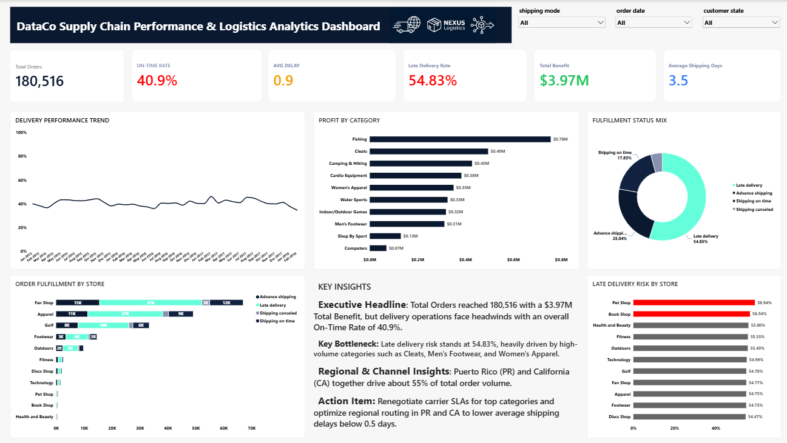

# 📦 DataCo Smart Supply Chain Analytics

### SQL | Python | Power BI | Supply Chain Analytics

An end-to-end data analytics project focused on analyzing supply chain operations, delivery performance, shipping efficiency, and profitability using SQL, Python, and Power BI.

---

## 📌 Project Overview

The **DataCo Smart Supply Chain Analytics** project explores supply chain data to identify operational inefficiencies, understand delivery performance, and generate actionable business insights.

This project follows an end-to-end data analytics workflow, from data exploration and SQL analysis to Python-based analysis and interactive Power BI dashboard development.

## 🎯 Project Objectives

- Analyze order and delivery performance.
- Identify late delivery risks.
- Evaluate shipping and fulfillment efficiency.
- Understand category-wise profitability.
- Track key supply chain performance indicators.
- Generate data-driven recommendations for operational improvement.

## 🛠️ Tools & Technologies

| Tool | Purpose |
|---|---|
| PostgreSQL | SQL queries and data analysis |
| Python | Data exploration and analysis |
| Power BI | Interactive dashboard development |
| DAX | KPI calculations and measures |
| Power Query | Data cleaning and transformation |
| Excel / CSV | Dataset handling |

## 📂 Repository Contents

- `DataCo_Supply_Chain_Analysis.pbix` – Power BI dashboard file
- `Dashboard.png` – Screenshot of the final dashboard
- `explore_data.py` – Python data exploration script

## 📊 Power BI Dashboard

The interactive dashboard provides an overview of supply chain performance through key metrics and visualizations.

### Key Performance Indicators (KPIs)

- Total Orders: 180,516
- On-Time Delivery Rate: 40.9%
- Average Delay: 0.9 Days
- Late Delivery Rate: 54.83%
- Total Benefit: $3.97M
- Average Shipping Days: 3.5

### Dashboard Features

- Delivery Performance Trend (Monthly)
- Profit by Category
- Fulfillment Status Distribution
- Order Fulfillment by Store
- Late Delivery Risk by Store
- Interactive filters for Shipping Mode, Order Date, and Customer State

## 🖼️ Dashboard Preview

  

## 🧮 SQL Analysis

PostgreSQL was used to explore the dataset and identify important business patterns.

Key analysis areas:

- Shipping performance analysis
- Late delivery risk analysis by state
- Category-wise profitability analysis
- Delivery status distribution
- Ranking analysis using SQL window functions

## 🐍 Python Analysis

Python was used for initial dataset exploration and analytical preparation.

Key activities:

- Dataset inspection
- Understanding column names and data types
- Exploring missing values
- Reviewing data structure and distributions

## 📈 Business Insights

The analysis focuses on identifying:

1. Delivery performance patterns and potential delays.
2. Shipping and fulfillment efficiency.
3. Profitability differences across product categories.
4. Operational areas that may require improvement.
5. Opportunities to improve delivery reliability and customer satisfaction.

## 💡 Business Recommendations

- Monitor late delivery risks regularly.
- Improve shipping and fulfillment planning.
- Review operational performance across stores and regions where data is available.
- Track category-level profitability.
- Use KPIs to support continuous supply chain improvement.

## 📁 Dataset Information

The project uses the **DataCo Smart Supply Chain dataset**.

The raw CSV files are not included in this repository because of their large file size. Refer to the original dataset source for download instructions.

## 👩‍💻 Author

**Sakunthala S**

Aspiring Data Analyst | Power BI Developer

**Technical Skills:** SQL | Power BI | Python | Advanced Excel | DAX | Power Query | Data Visualization

🔗 [LinkedIn](https://www.linkedin.com/in/sakunthalasuriyan) | 🔗 [GitHub](https://github.com/sakunthala-suriyan) | 📧 sakunthalasuriyan992@gmail.com

---

⭐ If you find this project interesting, feel free to explore the repository and share your feedback.

**Thank you for visiting!**
